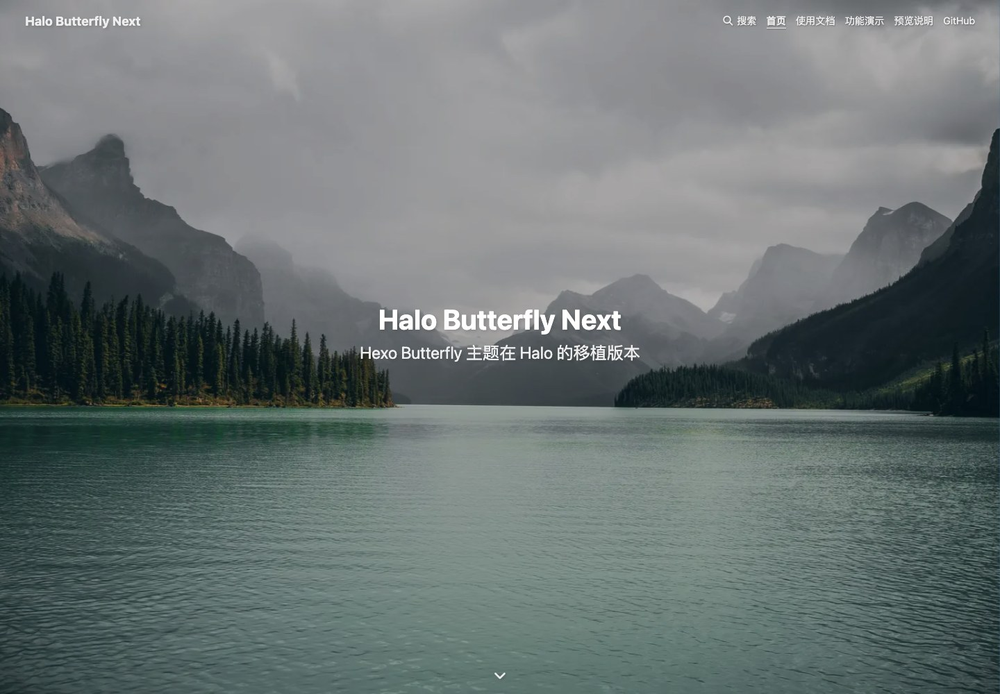
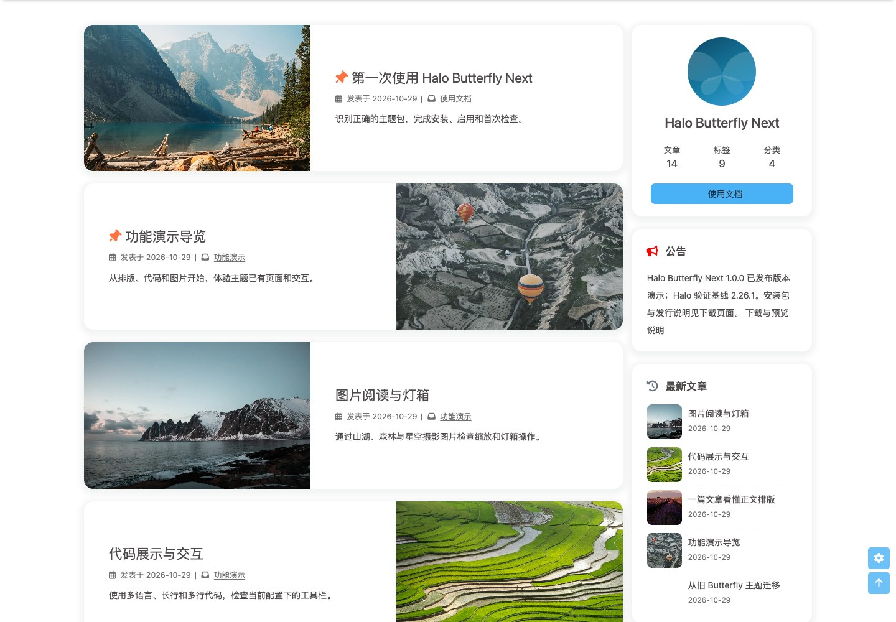
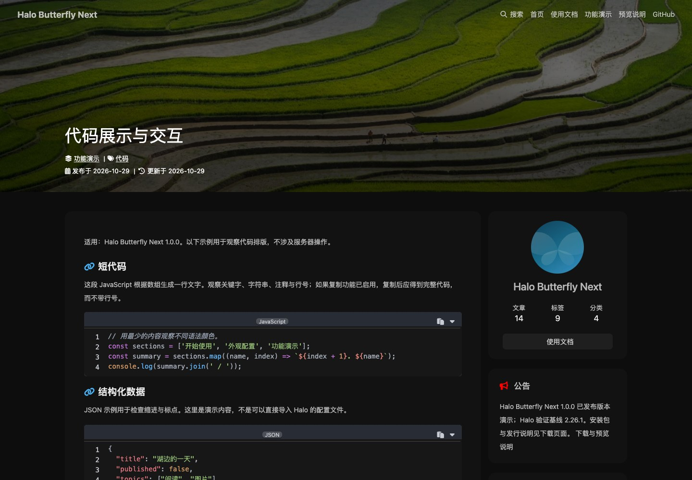
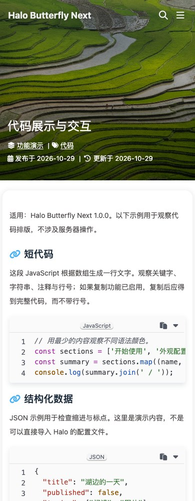

# Halo Butterfly Next

Butterfly 的 Halo 社区维护版，将 [Hexo Butterfly](https://github.com/jerryc127/hexo-theme-butterfly) 的布局、视觉风格与阅读体验带到 Halo。项目继承自[小红的 Halo 移植项目](https://github.com/dhjddcn/halo-theme-butterfly)，独立维护，不代表 Halo 或 Butterfly 官方。

[在线演示](https://butterfly.baizhukui.com/) · [使用文档](https://butterfly.baizhukui.com/docs) · [功能演示](https://butterfly.baizhukui.com/archives/demo-guide) · [下载 1.0.0](https://github.com/songxychn/halo-butterfly-next/releases/tag/v1.0.0)

## 特性

- **页面与布局**：全屏首页、文章封面卡片、分类、标签与归档，适配桌面和手机宽度。
- **外观配置**：亮暗配色、顶图、本地字幕、导航与侧栏卡片，可按站点风格调整。
- **正文排版**：提示、折叠、Tabs、时间线、链接按钮、图片网格与系列卡片，使用可读 HTML 保留内容结构。
- **Halo 集成**：对接官方搜索、评论插件，提供数学公式、SEO 与站点验证配置说明。

## 页面预览

首页、文章卡片与正文的亮暗配色预览：





| 文章桌面暗色 | 文章手机宽度亮色 |
| --- | --- |
|  |  |

## 安装

主题要求 **Halo ≥2.20.2**。搜索与评论为可选功能，使用前请安装相应的官方插件：

| 功能 | 插件要求 | Halo 要求 |
| --- | --- | --- |
| 搜索 | SearchWidget ≥1.7.1，推荐 1.8.0 | 1.8.0 需 Halo ≥2.26.0 |
| 评论 | CommentWidget ≥3.3.2 | Halo ≥2.26.0 |

1. 在 [1.0.0 发行页](https://github.com/songxychn/halo-butterfly-next/releases/tag/v1.0.0)下载 `halo-butterfly-next-1.0.0.zip`。
2. 在 Halo 控制台的主题管理中上传安装包。
3. 配置并启用主题。

GitHub 自动生成的 Source code 压缩包用于源码构建，不能直接作为主题安装包上传。已有站点升级或迁移前，请先按[安装与升级指南](docs/INSTALL-UPGRADE.md)备份主题和配置。

## 使用文档

- [安装、升级与回退](docs/INSTALL-UPGRADE.md)
- [从原 theme-butterfly 迁移](docs/MIGRATION.md)
- [侧栏、图片与外观配置](docs/APPEARANCE-OPTIONS.md)
- [正文扩展](docs/CONTENT-EXTENSIONS.md)
- [数学公式与 KaTeX 插件适配](docs/MATH.md)
- [SEO、站点验证与代码注入](docs/SEO-INJECTION.md)
- [1.0.0 发行说明](releases/v1.0.0.md) · [变更记录](CHANGELOG.md)

## 开发与贡献

需要 **Bun 1.4.0** 和 **Python 3**：

```sh
bun install --frozen-lockfile --ignore-scripts
bun run verify
```

构建输出为 `dist/halo-butterfly-next-1.0.0.zip`。源码位于 `src/`，`templates/` 与 `dist/` 为生成物。构建方式见[源码与构建说明](docs/SOURCE-BUILD.md)，参与开发见[贡献指南](CONTRIBUTING.md)。

欢迎通过 [Issues](https://github.com/songxychn/halo-butterfly-next/issues)反馈问题或建议。报告问题时请附上主题、Halo、插件及浏览器版本和复现步骤，并移除日志中的密码、Token 与个人信息。

## 许可与致谢

主题采用 [GPL-3.0](LICENSE) 许可，感谢小红、Hexo Butterfly 作者及历代贡献者。第三方组件许可与来源见[第三方资源说明](docs/THIRD_PARTY.md)和[来源清单](third-party-licenses/UPSTREAM-ATTRIBUTION.txt)。
