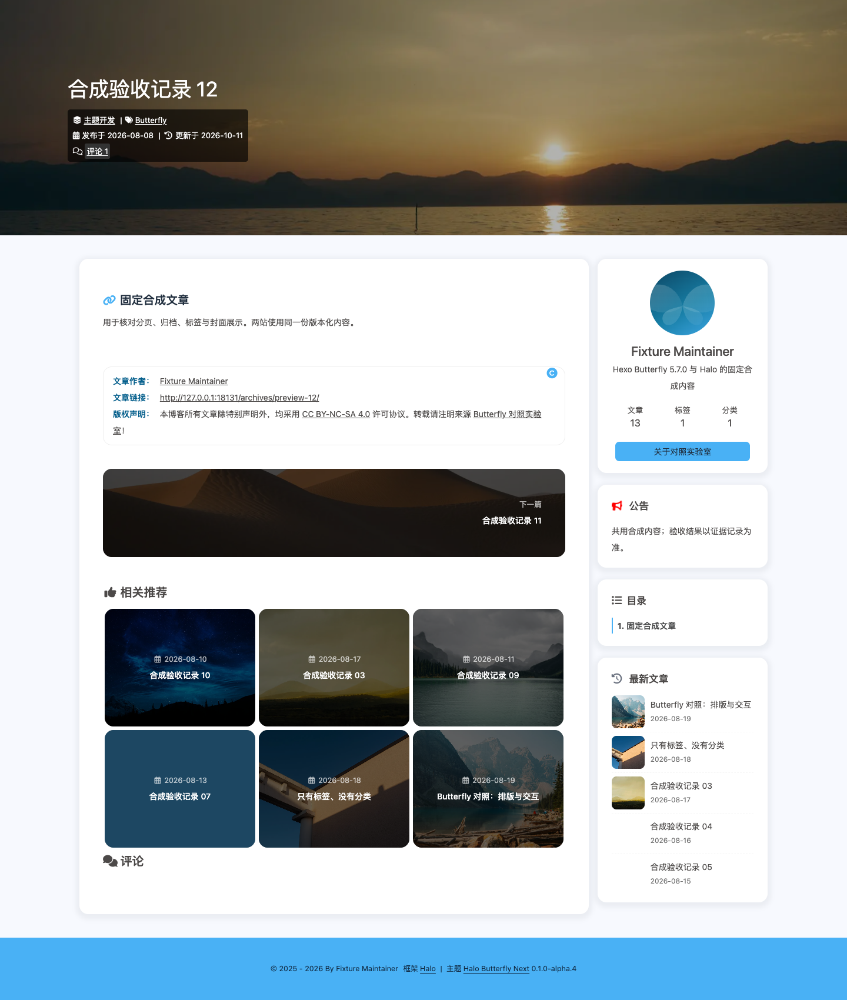
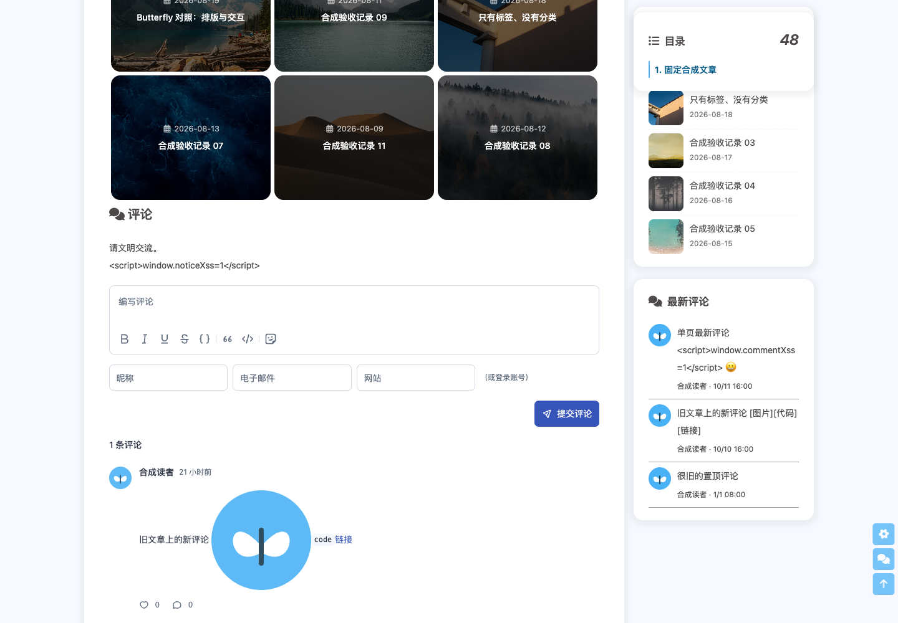
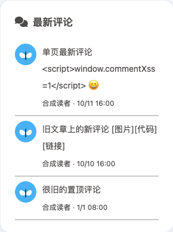
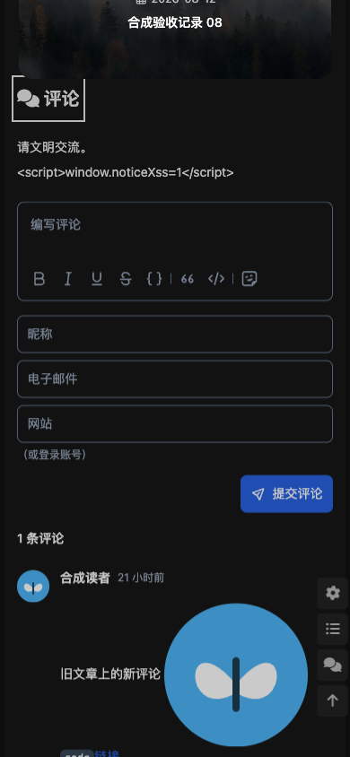

# 评论增强首批限定验证

实现及浏览器检查绑定提交 `a187dc72fbe867294ea538cb32dded4fd817d4b1`，已普通合并 master `4a3f0dd496b9a9a92d053ca24c16a9f7145db70c`。主题 ZIP SHA-256 为 `86c7db2636ec9b2ac2ba3130c1d639556e9ff5c9963655035fbf5c76aa15709c`，版本仍为 0.1.0-alpha.4；后续证据文档提交只改变包外材料，最终 PR head 的重建字节比对及 CI 单独记录。结构化证据、原报告摘要、失败用例与截图哈希见 [JSON](comment-enhancements.json)。

Bun 1.4.0 的完整 `bun run verify` 通过：594 项测试、117 个测试文件、严格类型检查、897 项矩阵一致性及 130 个安装文件检查。真实 Halo 为独占本地合成站的官方 2.26.1，CommentWidget 固定 3.3.2；Playwright 1.63.0 使用 Chromium 153.0.8010.12、Firefox 155.0、WebKit 26.6。桌面 1440×1000、手机视口 390×844 均覆盖实际亮暗模式。

最终 candidate-run-7 为 48/48 通过：跨文章与单页的时间排序、旧文章新评论、匿名请求、头像成功与损坏回退、文本安全、缓存命中/拒绝/损坏/到期/关闭、空结果与错误重试、私密及逐篇禁评后的暖缓存剔除、全局禁评、插件停用和恢复、配置关闭及工具栏展开组键盘操作、无脚本原生链接。文章与单页同时检查查询参数、评论片段、标题焦点、刷新和历史后退/前进；文章手动滚回章节后恢复锚点追踪。配置、插件状态和主体权限均在 finally 恢复并读回，恢复错误 0，页面脚本错误 0。

Firefox 历史前进失败源于恢复滚动触发章节追踪，抢先把 `#post-comment` 改写成 `#fixture`。评论导航期间保留目标，实际读者输入后解除保护；短页面评论仍在视口时继续保留评论片段。最终 Firefox 桌面/手机亮暗四组文章与四组单页均通过，包括手动返回章节。

原始失败报告未删除：candidate-run-1 为 11/44，run-2 为 26/47，run-3 为 46/48；包含预期永久链接尾斜杠错误、短页锚点、插件停用状态误判与 Firefox 历史问题。run-4 为 47/48，run-5 为 40/48，run-6 为 44/48；历史焦点已恢复，新增滚轮断言因评论仍可见、反向事件合并或向上滚动未完成而失败。独立 Chromium/Firefox 探针确认实际到达章节后追踪恢复，检查改为按实际位置补足距离，断言未移除。三个公开合成评论通过官方 Email owner/avatar 注解提供本地头像，避免 User 头像被 Attachment 协调器清除造成无图片时误通过。

首次验证的冻结默认快照检查失败后按新增设置重冻；最终合并同时保留顶图与评论默认字段。可选 Hexo 参考站准备失败，未完成双站对照。保留的资源状态和请求取消记录不是完整资源矩阵验收，也不关闭 #338。卡片审核/编辑缓存时效、冷查询成本及配置回退见 [功能文档](../../COMMENT-ENHANCEMENTS.md)。

10 条评论矩阵记录只提升为 implemented-unverified，0 条提升 verified。独立审查、完整双站合同、物理手机/真实 Safari/辅助技术、Moment 评论及组件懒挂载仍待完成。本轮不发布主题、不部署线上。

截图来自同一合成站；前图为整页，后图为评论定位后的视口，不能据此宣称完整像素对齐：

| 基线桌面亮色 | 候选桌面评论区 |
| --- | --- |
|  |  |

| 最新评论卡片 | 手机视口深色评论区 |
| --- | --- |
|  |  |
