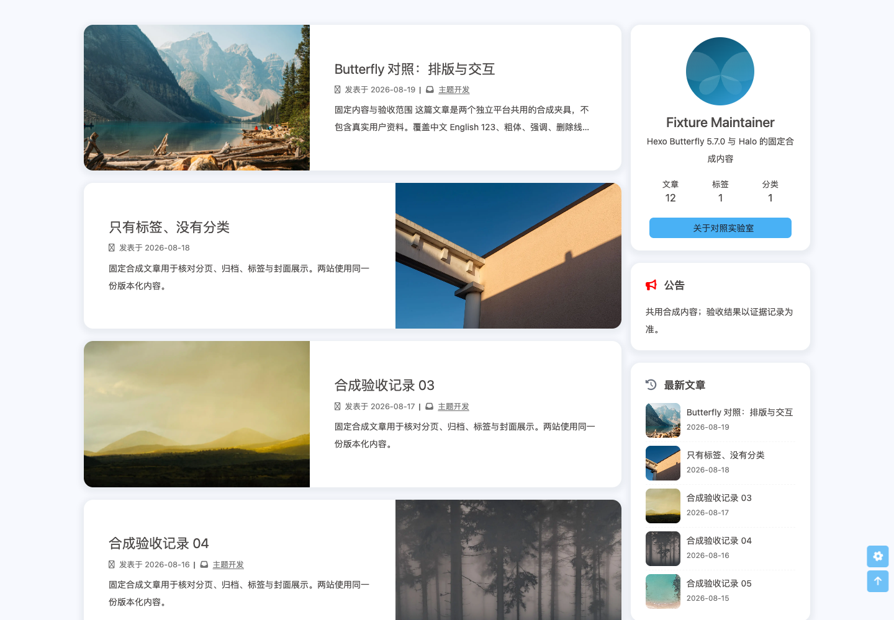
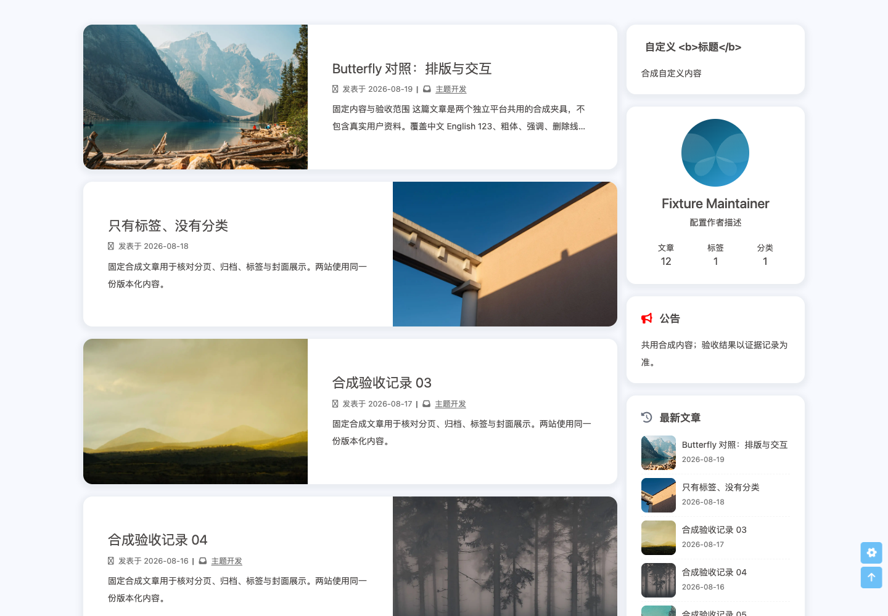

# 侧栏、图片与外观配置：限定验证

当前产品对应普通合并提交 `1b4df00c76e4830920a47d457619371cc5887dcc`，合并 master `2105dc38e9e561f9d7b3814fad0f37cb02146709` 的导航/加载功能。ZIP SHA-256 `41d4c6c46ec1e9e2230f255f2f21d71a00971e997bad3424589332bd0845fb43`，146 个实际安装文件与包一致。共同图片片段保留颜色封面与 deferred/noscript 输出；坏图处理统一到懒加载模块，清除旧 srcset、回退一次，并覆盖缓存坏图及关闭/仅文章加载。

`bun run verify` 通过 617 项测试及完整门禁。[真实 Halo 84 项配置复验](appearance-navigation-merge.json)全部通过；[20 项交叉复验](appearance-navigation-cross.json)覆盖 native/deferred/post/off 四种加载模式的友链回退（桌面/手机明暗共 16 项），以及每种尺寸/明暗连续 4 次首页与分类页局部导航（4 项），窗口标记保持，字体、主题色和单个 theme-color meta 正常。配置与文章封面均恢复。启用独立特效脚本的页面沿用导航模块的未知脚本保护，使用完整页面导航；本次未扩大局部导航支持范围。后续文档提交不改变构建输入，CI 绑定最终 head。

此前产品对应普通合并提交 `078cd40836c4db5f51bb290229133ace31bb2547`，主题 `0.1.0-alpha.4`，ZIP SHA-256 `9d73c43f0111417b1bc8820ea6dd1919bafd1b2e97f69257744087f5a6f48d0c`。接入 master `329463a` 的 SEO/代码注入功能后，重生成设置默认值与矩阵，`bun run verify` 的 613 项测试和 146 文件包检查通过；真实 Halo 2.26.1（18143）实际安装逐文件一致，84 项外观配置检查全部重跑通过。另执行 SEO 检查器的 36 项 HTTP/模板检查通过，配置、系统设置及页面恢复。见[合并浏览器记录](appearance-merge.json)、[SEO 交叉检查](appearance-merge-seo.json)。后续文档提交不改变构建输入；PR 当前 head 的 CI 单独跟踪。

以下保留合并前产品提交 `6ce0dfd054f607b0419be052a9242334c77b5c5a`，ZIP SHA-256 `61bf5bbdf47b773a1a23d59cf00b0c0e5bf9d543ca5e27da69e5b25f219fcc3e` 的原始限定检查及截图；当时实际安装 143 个文件与 ZIP 一致。旧报告不能替代上方合并包的检查。

`bun run verify` 通过类型检查、矩阵检查、613 项工程测试、构建与 143 文件安装包检查。限定真实页面检查 84 项通过：21 组场景分别运行 1440×1000、390×844，浅色/深色；每项检查初始化完成、Loading 释放及无水平溢出。详见[机器报告](appearance-browser.json)和[身份摘要](appearance-summary.json)。

场景涵盖旧默认值、作者描述/按钮/图标、自定义卡片及文章卡片、关闭侧栏、标签亮暗自定义色、分类列表、标签云、字体/标题样式表/正文美化/两端对齐/主题色、清空设置回退、图片与颜色封面候选、空候选、友链一次回退和失败图也坏、静态/飘动彩带、手机禁用、连线背景、烟花/爱心/文字点击、输入粒子（文本响应而密码不响应）、减少动态效果。

PluginLinks 2.3.0 已启动，JAR SHA-256 `96ec593d97912f6f3069cc184004389459ac842cea20212eb664c2ca19862f86` 与仓库锁一致。其他插件启停和版本保存在机器报告，不据本次声明它们的完整集成验收。临时主题设置和文章封面已恢复；原设置只保留在 git 忽略的私有实验目录。

[补充检查](appearance-supplemental.json)确认禁用 JavaScript 后分类页原统计图设置仍输出可见列表（`MainApp` 未执行，主内容为 block）；重复调用外观/侧栏初始化后卡片仍为 7、字体与主题色 meta 各为 1、坏图错误监听仅绑定 1 次，移除旧 srcset 后回退图片实际加载。分类检查用同一隔离会话持续携带 `--args '--blink-settings=scriptEnabled=false'`；初次在后续命令遗漏启动参数导致会话重启和空页超时，属于检查器参数问题。补充过程只改合成浏览器 DOM，没有保存服务器配置。

## 截图

同一包在原默认设置和本批设置下的侧栏对比：

| 默认设置 | 自定义卡片、描述覆盖及关闭按钮 |
| --- | --- |
|  |  |

[手机深色外观](appearance-post-390-dark.png)、[颜色封面候选](cover-candidate-color-1440-light.png)。截图滚动到主内容区；手机侧栏继续遵循原主题响应式显示规则。

## 保留失败与范围

首轮 `87e3b43` 的 60 项检查有 20 项失败，保留[完整报告](appearance-first-run.json)。Halo 将整组配置和 repeater 行序列化为 `realNode` 包装；浏览器现在在首次绘制前解包。友链失败图请求虽成功，Halo 生成的旧 `srcset` 仍覆盖回退地址；现在移除旧响应式来源后再回退。首轮检查器还误选侧栏“查看全部标签”按钮及比较相对地址，已修正选择器、地址和真实图片宽度断言。

修复提交 `d3e688a`、包 `641cf18b…` 的 80 项检查通过，原设置恢复。随后补静态彩带 resize 重绘、实际安装比对和输入场景；最新 84 项对应上方产品提交与包身份。两轮身份均保留在摘要，旧报告不充当新包验收。

参考 Hexo 准备在 `hexo clean --silent`（Bun 1.4.0）返回 2，原日志保留在本地 `/tmp/halo-appearance-prepare.log`；没有执行双站截图或等价验收。Halo 首次种子步骤先于安装主题而未完成，安装后重新播种成功；不把该准备失败算作产品通过。

本批使用独立无头 Chromium；完整双站等价、Firefox/WebKit、真实 Safari/设备、读屏、性能、独立审查及全部 1.0 合同仍待完成。自维护特效和稳定封面索引不声明与上游第三方 SDK/随机算法全等。矩阵更新 71 条限定实现说明，69 条缺口/待映射改为 `implemented-unverified`，2 条补说明；0 条提升为 `verified`。未发行或部署。
